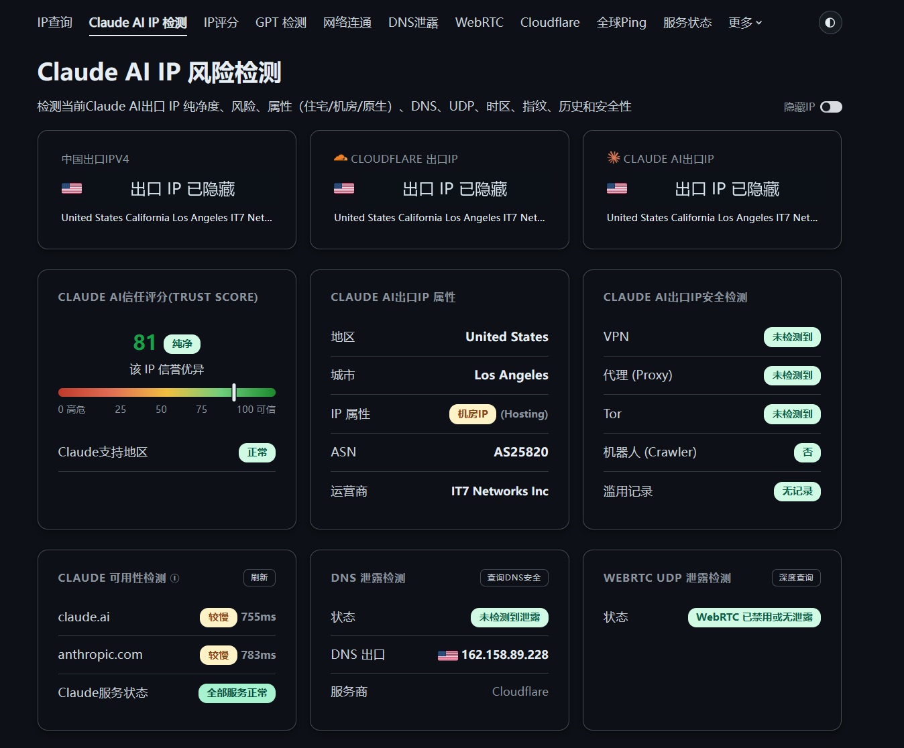

# Clash Subscription Sync

[](LICENSE)

Clash Verge Rev 的 Windows 订阅同步工具。

这是 Windows 上的轻量订阅同步工具。功能是：**本地网络 → 使用者自己的机场节点 → 使用者自己的固定出口 → 网站**。机场更新节点域名、IP、端口或密码后，后台重建链路并同步 TUN 所需的端点路由。

项目只含程序、配置模板和说明，不含作者的出口 IP、机场订阅、节点密码、UUID、运行日志、历史备份或 Clash 成品配置。它也不附带代理服务；每个使用者必须有自己的机场和最终出口。

## 必须先了解：不保证整机所有出口 IP 都是目标 IP

**仅打开 Clash 程序，不代表整台电脑所有网络流量都只能从目标 IP 出去。** 本项目实现的是固定代理链路和机场订阅同步，**不是系统级强制出口隔离**，也不包含断网保护（kill switch）。

- 需要开启 **TUN＋全局模式**，并选择本工具生成的节点；被 Clash 接管且成功建立的 TCP、UDP 连接，按配置经过使用者自己的最终出口。
- 本工具不修改系统防火墙来阻止绕行。未被 TUN 接管的流量、系统 IPv6、其他 VPN/虚拟网卡、手动直连模式等，可能走本地网络或其他出口。
- 生成的代理组没有配置 `DIRECT` 作为故障回退，但这**不能阻止其他进程、其他接口或未接管的流量直出**。节点超时并不等于整台电脑都已被禁止联网。
- `expected_exit_ipv4` 仅用于登记使用者预期的出口，程序不会持续核验或强制公网 IP 等于该值；代理服务商更换出口也可能改变实际 IP。
- Cloudflare DoH 和 TUN DNS 劫持是本项目的配置策略，**不是所有应用、所有 DNS、所有 IPv6 和所有故障场景绝无泄漏的保证**。Clash 内关闭 IPv6，不等于 Windows 系统已禁止 IPv6。

请在安装后、切换节点后和更新订阅后，分别验证实际 TCP 出口、UDP/WebRTC、DNS 与 IPv6。测试结果只代表当时使用的节点与网络环境，不是长期或全机保证。

本项目**不提供“一开 Clash，整台电脑所有出口必定等于目标 IP”这一承诺**。若你的需求必须包含系统级出站隔离，请不要把本工具作为已经满足该需求的方案。

### 为什么不附带断网保护

早期本地实验尝试过在代理超时后封锁系统出站，并在完全退出 Clash 后恢复网络。实际测试出现过保护后台停止、受保护启动入口打不开、启动检查失败，以及退出后本地网络未及时恢复等问题。**这些实验没有通过可靠性验收，已经回退，相关后台、启动器和防火墙封锁代码不属于本开源版。**

因此，不能把早期实验描述为“代理失效时已经可以可靠阻止真实 IP 直出”，也不能把“已经回退、当前可联网”当作“断网保护验证成功”。本版只发布订阅同步、代理链路配置和端点路由维护功能。代理故障时，不提供系统级禁网或自动防泄漏承诺。

### v2rayN 是否等于系统级保护

**不能只凭使用 v2rayN、开启系统代理或开启 TUN，就认定存在可靠的系统级断网保护。** v2rayN 是代理客户端：“系统代理”主要供遵循系统代理设置的应用使用；TUN 可接管更广泛的流量，但仍需结合所用核心、路由、IPv6、例外流量及具体版本配置判断。

某个版本或核心的严格路由、防泄漏选项，与“在代理故障、核心崩溃、客户端退出和网卡切换时均保持正确的系统级隔离”不是同一项验收。是否满足需求，应对这些故障场景逐项实测，不能仅以客户端名称或 TUN 开关作保证。本项目也没有替 v2rayN 实现或验证这类保护。

例如界面显示“启用 Tun”“路由：V4-全局 (Global)”和“系统代理：清除系统代理”，只能据此判断启用了 TUN 并选中了一个全局路由预设；不能仅凭“V4”字样认定 Windows IPv6 已关闭，也不能据此认定存在代理失效时的系统级防火墙隔离。参阅 [v2rayN 官方：系统代理和路由说明](https://github.com/2dust/v2rayN/wiki/Description-of-system-proxy-routing)。


## 效果展示



截图由使用者提供，已遮挡个人代理出口 IP，保留 Cloudflare DNS 检测结果；原图没有纳入仓库。DNS 栏显示的解析器出口 IP 属于 DNS 服务的出站地址，不需要与最终代理出口 IP 相同；它也不是配置中的 DoH 入口地址 `1.1.1.1`/`1.0.0.1`。页面中的“Cloudflare 出口 IP”卡片反映的是访问网站时的代理出口，不能仅凭该卡片证明 DNS 上游。

本工具生成的 DNS 上游为 Cloudflare 的 `https://1.1.1.1/dns-query` 和 `https://1.0.0.1/dns-query`，通过代理传输。截图的 DNS 服务商一栏也显示 Cloudflare；但页面内的评分、可用性、DNS 和 WebRTC 状态仍是第三方网站当时的结果，仅作示例，不构成对任何服务的可用性、账号稳定性或绝无泄漏的保证。“WebRTC 已禁用或无泄露”不能替代实际 UDP 出口测试。

## 准备条件

- Windows 10/11，已安装 Clash Verge Rev 和服务模式，能正常使用自己的机场订阅。
- Python 3.8 或以上，含 `pythonw.exe`。建议 Python 3.10–3.12，依赖为 `PyYAML` 和 `psutil`。
- 一个支持 UDP 的最终出口代理节点，以及服务商提供的预期出口 IPv4。
- 一个本地可直连的 DNS 引导代理节点，用于经 Cloudflare DoH 解析机场服务器域名。它可与最终出口是同一节点，也可不同。
- 最终出口与引导节点的 **server 均填写公网 IPv4**，TLS 的域名填入 `sni` 等对应字段。仅购买一个 IP 而没有协议、端口和认证信息，无法使用。

本版支持填写 Trojan、Shadowsocks、VMess、VLESS、SOCKS5、TUIC、Hysteria2 和 AnyTLS 格式的完整节点。具体协议的 UDP 能力、TLS/Reality 参数和服务端兼容性由使用者自行确认；`udp: true` 无法让不支持 UDP 的服务器获得 UDP 能力。

若尚未安装 Python 依赖，在终端切换到解压目录后执行：

```powershell
py -3 -m pip install -r requirements.txt
```

本包不包含 Python、Clash、第三方依赖或任何节点密钥，也不会自动下载安装它们。

## 一次性安装

1. **先完整解压 ZIP** 到本机固定目录，不要在压缩包预览中直接运行。
2. 在 Clash 中导入并选中自己的机场远程订阅，确认原始机场可用，然后从托盘菜单完全退出 Clash。
3. 将 `user-config.example.yaml` 复制成 `user-config.yaml`。替换所有 `YOUR_...` 字段，填写自己的完整 `final_exit`、`bootstrap` 和 `expected_exit_ipv4`。`expected_exit_ipv4` 可以与代理服务器连接 IP 不同。机场订阅链接仍保存在自己的 Clash 中，无需复制到本工具。
4. 路径和物理网卡默认自动检测。如检测失败，填写 `clash_data_directory`、`clash_core_path` 和 `physical_interface`。物理接口应为真实的 Ethernet/以太网/Wi-Fi 名称，不能选 TUN 或其他 VPN 接口。
5. 双击 `01-Install.cmd`，由本人确认 Windows 管理员授权。管理员权限用于注册当前用户的同步任务和维护代理端点 `/32` 临时路由。请使用安装 Clash 的同一 Windows 账号；不支持在授权时改用另一个账号。
6. 出现 `SUBSCRIPTION SYNC INSTALLED` 后关闭安装窗口，通过**原来的 Clash 快捷方式**启动，使用 **TUN＋全局模式**。

如果有多个 Python，可在终端先设置 `CLASH_SYNC_PYTHON` 为所需 `python.exe` 的完整路径，再运行安装脚本。本包没有预设任何特定用户名。

首次安装会经本人填写的引导代理访问 Cloudflare，解析订阅端点，再让 Mihomo 校验生成配置。失败会停止安装；写入阶段失败会恢复备份。安装成功代表初始化和后台启动通过，**不等于对方电脑的 TCP/UDP 出口、DNS 泄漏和所有协议均已实测**。

## 日常更新和切换节点

打开原来的 Clash 图标，在“订阅”页点击机场卡片的刷新按钮。后台一般在数秒内检测变化，解析和重载可能需要更长时间；更新期间保留上一次已生成的链路，不增加直接连接的备选项。

“代理”页的机场节点名称对应完整的“该机场 → 自己的最终出口”链路，原生延迟测速也是这条链路的 HTTPS 延迟，不能当成机场单段 ping。订阅不包含在分享包里，每个人看到的名称来自自己的订阅。

状态显示在解压目录的 `sync-status.json`：`WAITING` 等待 Clash；`SYNCING` 准备更新；`READY` 已加载；`RETRY` 保留原配置稍后重试。安装和使用后这些文件会包含**使用者自己的节点名称、出口信息**，不要把使用过的目录原样重新打包转发。

后台在当前用户登录时启动，安装位置是系统 ProgramData 下的 `ClashSubscriptionSync`。请保留解压目录，以便查看状态和卸载。添加新的机场远程订阅后，检查其扩展脚本选项为 `SubSync`；不要用另一个会覆盖本工具输出的脚本或覆写配置。

如果换到另一张物理网卡（例如以太网切到 Wi-Fi），先退出 Clash，卸载同步器，修改模板中的物理网卡设置后重新安装。此版不自动迁移跨网卡状态。

## 能力范围

- 通过 Cloudflare `1.1.1.1`/`1.0.0.1` 的 HTTPS DNS 查询，不使用运营商 DNS 作为本工具的解析回退。
- 保留原生 TUN DNS 劫持，IPv6 默认关闭；普通域名经所选最终出口访问 Cloudflare，引导解析经本人填写的引导节点。
- 仅管理自己添加的代理端点 `/32` 路由，不更改默认网关、网卡 DNS、系统代理、防火墙或 Clash 快捷方式；退出 Clash 后清理自己添加的路由。
- **没有断网保护、系统级防泄漏开关或绝不直连保证**。本工具不验证或强制公网出口 IP；`expected_exit_ipv4` 是使用者登记的信息，实际结果要自行测试。
- 未被 TUN 接管的应用、系统 IPv6、浏览器独立 DNS、其他 VPN/虚拟网卡及手动直连模式可能改变结果。关闭 Clash 中 IPv6 不等于关闭 Windows IPv6。
- 后续更新需要当前代理仍可用。如果当前机场节点已失效，请先换一个仍可用节点；全部机场节点失效时，可能需要修复自己的订阅或重新初始化，无法承诺自动救活。
- 刷新域名失败时对应候选节点会被跳过；全部失败则保留原配置。状态为 READY 只表示配置加载完成，并不保证全部节点都能连接。

安装后请自行测试 TCP、UDP/WebRTC、DNS 和 IPv6，确认符合自己的使用需求。本版核心链路源于已测试的个人版本，但不同节点、Windows 网络环境和 Clash 版本的组合不能由作者替对方完成验收。

## 卸载和恢复

完全退出 Clash，运行 `02-Uninstall.cmd`，确认管理员授权。卸载同步任务并清理自己添加的端点路由，保留最后一次生成的 Clash 配置，原快捷方式不变；卸载后订阅不再自动适配。

若要同时恢复安装前的 Clash 配置，在卸载后，以管理员 PowerShell 运行安装目录内的恢复程序：

```powershell
& "$env:ProgramData\ClashSubscriptionSync\Uninstall.ps1" -RestoreOriginalConfig
```

也可手动使用 Clash 配置目录中 `repair-backups/subscription-sync-share-*` 的本机备份。备份、`user-config.yaml` 和 ProgramData 的 `data` 目录会包含使用者自己的密码；卸载会保留它们以便恢复，确认不再需要后由本人自行删除。

## 分享注意

只转发原始 ZIP。不要把你填好的 `user-config.yaml`、`data`、`settings.json`、`sync-status.json`、安装日志、备份、`__pycache__` 或任何机场配置一起分享。

## 开源许可与开发

原创代码以 [MIT License](LICENSE) 发布。第三方组件保留各自许可证，见 [THIRD_PARTY.md](THIRD_PARTY.md)。本项目不隶属于 Clash Verge Rev、Cloudflare 或截图中出现的任何服务。

```sh
python -m pip install -r requirements.txt
python -m unittest discover -s tests -v
```

请阅读 [CONTRIBUTING.md](CONTRIBUTING.md) 和 [SECURITY.md](SECURITY.md)。不要提交真实节点配置或订阅资料。
